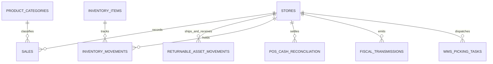

**🇺🇸 English** | [🇧🇷 Português](README.pt-BR.md)

# 🗄️ tsql-retail-ops-analytics

[](https://github.com/gavicoding/tsql-retail-ops-analytics/actions/workflows/ci.yml)
[-CC2927.svg)](https://learn.microsoft.com/sql/t-sql/)
[](LICENSE)

A **100% synthetic, production-inspired T-SQL / SQL Server analytics and DBA toolkit** demonstrating real-world multi-store retail operations, warehouse logistics (WMS), POS/fiscal reconciliation, lock contention observability, and least-privilege RBAC.

> **Privacy Note:** All table structures, columns, stored procedures, and seed records in this repository are **100% synthetic** and built strictly to showcase T-SQL engineering patterns without exposing any proprietary ERP schema or company data.

---

## Core Patterns Demonstrated

- **Single-Pass Conditional Aggregation:** Computes store/daily net sales alongside strategic category subtotals and share percentages in one scan without row multiplication (`SUM(CASE WHEN ...)` + `NULLIF`).
- **Window-Function Deduplication (`ROW_NUMBER()`):** Eliminates duplicate rows when returnable containers/assets complete multiple trips between distribution centers and retail stores (`PARTITION BY asset_code ORDER BY moved_at DESC`).
- **SARGable Date-Range Filtering:** Uses half-open `DATETIME2` intervals (`>= @start_date AND < DATEADD(DAY, 1, @end_date)`) aligned with covering/filtered nonclustered indexes (`schema/02_indexes.sql`).
- **Multi-Mode Parameterized Stored Procedures:** Consolidated (`'C'`), Detailed (`'D'`), and Full-Item Audit (`'A'` via `LEFT JOIN`) reporting + transactional key-value updates (`BEGIN TRY` / `UPDLOCK, HOLDLOCK` / `THROW`).
- **DBA Observability & Least-Privilege Security:** Out-of-band `sys.dm_tran_locks` wait capture, `msdb` SQL Agent job health ranking, and `db_readonly_analytics` role grants (`GRANT SELECT` + schema-level `DENY` writes).

---

## Synthetic Schema ER Diagram



---

## Script Catalog

| Category | File | Business Problem & T-SQL Techniques |
| :--- | :--- | :--- |
| **Schema** | [`schema/01_schema.sql`](schema/01_schema.sql) | Multi-store retail, returnables, inventory, POS/fiscal, WMS & lock-log DDL |
| **Indexes** | [`schema/02_indexes.sql`](schema/02_indexes.sql) | Covering indexes (`INCLUDE`) & filtered index for active WMS backlog |
| **Seed** | [`schema/03_seed_data.sql`](schema/03_seed_data.sql) | Synthetic multi-store & multi-trip container test dataset |
| **Query** | [`queries/01_net_sales_strategic_categories.sql`](queries/01_net_sales_strategic_categories.sql) | Single-pass net sales & strategic category share (`CASE WHEN`, `NULLIF`) |
| **Query** | [`queries/02_returnable_asset_latest_movement.sql`](queries/02_returnable_asset_latest_movement.sql) | Deduplicated latest movement per asset via `CTE` + `ROW_NUMBER()` |
| **Query** | [`queries/03_returnable_assets_pending_audit.sql`](queries/03_returnable_assets_pending_audit.sql) | Pending return aging (`DATEDIFF`) & operator accountability (`seq = 1`) |
| **Query** | [`queries/04_pos_cashflow_fiscal_reconciliation.sql`](queries/04_pos_cashflow_fiscal_reconciliation.sql) | Dual-CTE store tender variance & fiscal transmission health audit |
| **Query** | [`queries/05_wms_picking_bottlenecks.sql`](queries/05_wms_picking_bottlenecks.sql) | Stage backlog (`PICKING`, `CHECKOUT`, `TRANSFER`) & avg cycle duration |
| **Proc** | [`procedures/usp_inventory_movements_report.sql`](procedures/usp_inventory_movements_report.sql) | Multi-mode `'C'`/`'D'`/`'A'` procedure with SARGable range bounds |
| **Proc** | [`procedures/usp_safe_config_update.sql`](procedures/usp_safe_config_update.sql) | Transactional key-value config update (`UPDLOCK`, `TRY...CATCH`, audit row) |
| **DBA** | [`observability/01_lock_contention_snapshot.sql`](observability/01_lock_contention_snapshot.sql) | Out-of-band `sys.dm_tran_locks` + `sys.dm_exec_requests` `WAIT` logger |
| **DBA** | [`observability/02_sql_agent_jobs_health.sql`](observability/02_sql_agent_jobs_health.sql) | Latest outcome per scheduled job via `msdb.dbo.sysjobhistory` + `ROW_NUMBER()` |
| **RBAC** | [`security/01_readonly_analytics_grants.sql`](security/01_readonly_analytics_grants.sql) | Least-privilege `db_readonly_analytics` role (`GRANT SELECT` + `DENY` writes) |

---

## Before vs. After Optimization Highlights

| Scenario | Before (Bottleneck / Risk) | After (T-SQL Engineering Fix) |
| :--- | :--- | :--- |
| **Multi-trip returnable boxes** | Flat `SELECT` returned duplicate rows per asset after multiple cycles, inflating counts and hiding current custody | `ROW_NUMBER() OVER (PARTITION BY asset_code ORDER BY moved_at DESC, movement_id DESC)` isolates strictly the latest movement (`rn = 1`) with operator badge |
| **Strategic category reporting** | Multiple separate queries and manual spreadsheet reconciliation risked mismatched date filters or double counting | Unified single-pass `SUM(CASE WHEN is_strategic = 1 ...)` calculates total and strategic subtotals simultaneously |
| **Date-range filtering on movements** | Wrapping indexed `DATETIME2` columns in `CAST(col AS DATE) BETWEEN ...` prevented index seeks | Half-open bounds (`>= @range_start AND < DATEADD(DAY, 1, @end_date)`) enable index seeks on `IX_inventory_movements_movedat_item` |
| **Peak-hour slowdown investigation** | Heavy live probing or transient observation missed root causes behind brief transaction blocks | Out-of-band `sys.dm_tran_locks` (`WAIT`) snapshots persisted into `db_latency_lock_logs` for offline trend analysis |

---

## Automated Verification & Execution

### Run Automated Structural + Analytical Tests (No SQL Server Required)

```bash
python -m unittest discover -s tests -v
```

Validates balanced `BEGIN`/`CASE`/`END` blocks, SARGable date predicates, guarded `UPDATE`/`DELETE` statements, and executes the analytical query logic against an in-memory SQLite dataset matching `schema/03_seed_data.sql`.

### Run Against SQL Server (2019 / 2022+)

Execute scripts in order via SSMS, Azure Data Studio, or `sqlcmd`:
1. `schema/01_schema.sql`
2. `schema/02_indexes.sql`
3. `schema/03_seed_data.sql`
4. `procedures/*.sql`, `security/*.sql`, and `queries/*.sql`

---

## License

Apache License 2.0 — see [LICENSE](LICENSE).
