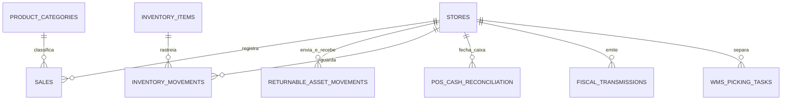

[🇺🇸 English](README.md) | **🇧🇷 Português**

# 🗄️ tsql-retail-ops-analytics: correções de SQL Server vindas da produção

[](https://github.com/gavicoding/tsql-retail-ops-analytics/actions/workflows/ci.yml)
[-CC2927.svg)](https://learn.microsoft.com/sql/t-sql/)
[](LICENSE)

Problemas reais de **SQL Server** que resolvi no trabalho, refeitos sobre um banco **inteiramente fictício** (uma rede de lojas inventada, com estoque, caixas retornáveis, notas fiscais e depósito). Cada caso mostra o antes, o depois e o porquê, e **tudo roda num SQL Server 2022 de verdade a cada mudança** (CI), com testes que falham se o resultado estiver errado.

> **Sobre os dados:** tabelas, colunas, procedures e registros são todos inventados. Nada aqui vem de um sistema ou de uma empresa real.

---

## Para que serve

Para quem trabalha com SQL Server e já esbarrou em algum destes problemas:

- relatório que fica lento ou quebra quando um filtro opcional vem vazio;
- importação em lote que duplica registro ou para no primeiro erro;
- painel que tenta somar 12 meses de log a cada abertura e estoura o tempo;
- itens contados em dobro porque fizeram mais de uma viagem;
- precisar automatizar um sistema de terceiros sem saber quais procedures ele usa;
- dar acesso a um robô sem dar acesso demais;
- atender um pedido de eliminação de dados da LGPD sem quebrar pedidos e relatórios.

## O que você ganha

- **Padrões prontos para adaptar**, cada um com o antes e o depois lado a lado.
- **Prova, não só descrição:** os scripts rodam num SQL Server 2022 a cada mudança e os testes conferem o resultado.
- **O porquê de cada escolha**, comentado no próprio código.

---

## Antes e depois

| Situação | Antes (o problema) | Depois (a correção) |
| :--- | :--- | :--- |
| **Caixas retornáveis com várias viagens** | A consulta trazia uma linha por viagem, a contagem inflava e não dava para saber com quem a caixa estava | `ROW_NUMBER() OVER (PARTITION BY asset_code ORDER BY moved_at DESC, movement_id DESC)` pega só o último movimento (`rn = 1`), com o operador responsável |
| **Relatório por categoria estratégica** | Várias consultas separadas e conferência em planilha, com risco de filtro de data diferente ou soma em dobro | Uma consulta só com `SUM(CASE WHEN is_strategic = 1 ...)` calcula o total e o subtotal juntos |
| **Filtro por período em tabela grande** | `CAST(coluna AS DATE) BETWEEN ...` impedia o uso do índice | Intervalo semiaberto (`>= @inicio AND < DATEADD(DAY, 1, @fim)`) usa o índice `IX_inventory_movements_movedat_item` |
| **Lentidão em horário de pico** | Bloqueios curtos sumiam antes de alguém conseguir olhar | Fotos de `sys.dm_tran_locks` gravadas em `db_latency_lock_logs` para analisar depois |
| **Relatório com filtro opcional por produto** | Campo vazio quebrava a conversão; `ISNUMERIC` aceitava `'$'`, `'1e5'` e `'12,5'`; um único plano em cache servia tanto a busca de um produto quanto o período inteiro (parameter sniffing) | `TRY_CONVERT(INT, NULLIF(LTRIM(RTRIM(@p)), N''))` (atenção: `TRY_CONVERT(INT, '')` dá `0`, não `NULL`), `(coluna = @id OR @id IS NULL)` e `OPTION (RECOMPILE)` ([`usp_purchase_items_report`](procedures/usp_purchase_items_report.sql)) |
| **Importação em lote vinda de uma API** | Um insert por vez, e a rodada inteira falhava no primeiro registro repetido | Um comando só: tira repetidos dentro do lote com `ROW_NUMBER()`, `NOT EXISTS` nas duas chaves com `UPDLOCK, HOLDLOCK` e `OUTPUT ... INTO @tabela` ([`usp_ingest_invoice_index_batch`](procedures/usp_ingest_invoice_index_batch.sql)) |
| **Painel sobre um log enorme** | Somar 12 meses numa consulta levava mais de 2 minutos e estourava o tempo | Resumo montado aos poucos: alguns dias por rodada, último estado de cada documento, `MERGE` que pode rodar de novo sem duplicar ([`usp_refresh_daily_emission_summary`](procedures/usp_refresh_daily_emission_summary.sql)) |
| **Pendências com `EXISTS` linha a linha** | O `EXISTS` em cada linha passava dos 15 segundos de limite, e `EXISTS` dentro de `SUM` nem é permitido (erro 130) | Duas etapas: grava numa `#temp` indexada com uma marcação e depois soma ([`06_contingency_backlog_two_stage`](queries/06_contingency_backlog_two_stage.sql)) |
| **Automatizar um sistema de terceiros** | Gravar direto nas tabelas pula as regras de estoque, financeiro e auditoria | Uma sessão curta e filtrada de Extended Events mostra quais procedures o sistema chama, e a automação passa a chamar as mesmas ([`03_trace_app_calls_with_xevents`](observability/03_trace_app_calls_with_xevents.sql)) |
| **Robô que prorroga acessos temporários** | Com permissão nas tabelas, o robô poderia criar acessos ou mudar o horário de início | Papel com `EXECUTE` em uma única procedure que só aumenta o horário de término, e escrita direta negada ([`02_time_boxed_access_extension`](security/02_time_boxed_access_extension.sql)) |
| **Pedido de eliminação de dados (LGPD Art. 18)** | Apagar o cliente quebra pedidos e relatórios fiscais; trocar o CPF por um hash só pseudonimiza, porque dá para descobrir testando todos os CPFs | Anonimização irreversível: CPF trocado por um código aleatório, dados pessoais removidos, data de nascimento reduzida ao ano, pedidos mantidos pelo prazo legal, hash de evidência e auditoria sem nenhum dado pessoal ([`usp_anonymize_customer`](procedures/usp_anonymize_customer.sql), comprovado por [`02_privacy_assertions`](tests/sql/02_privacy_assertions.sql)) |

---

## Outras técnicas no repositório

- **Soma condicional numa passada só** (`SUM(CASE WHEN ...)` + `NULLIF`) para total, subtotal e percentual sem multiplicar linhas.
- **Procedure com vários modos de relatório**: consolidado (`'C'`), detalhado (`'D'`) e auditoria item a item (`'A'`, com `LEFT JOIN`).
- **Atualização segura de parâmetros**: transação com `UPDLOCK`, `TRY...CATCH`, `THROW` e linha de auditoria.
- **Saúde dos jobs do SQL Agent**: último resultado de cada job (`msdb.dbo.sysjobhistory` + `ROW_NUMBER()`).
- **Usuário só leitura para análise**: papel `db_readonly_analytics` com `GRANT SELECT` e escrita negada (`DENY`).

## O banco fictício



A lista completa de arquivos, com o problema que cada um resolve, está no [README em inglês](README.md#script-catalog).

---

## Testes

### Testes rápidos (não precisam de SQL Server)

```bash
python -m unittest discover -s tests -v
```

Conferem a estrutura dos scripts (blocos `BEGIN`/`CASE`/`END` fechados, filtros de data que usam índice, `UPDATE`/`DELETE` sempre com `WHERE`) e rodam a lógica dos relatórios num SQLite em memória com os mesmos dados de `schema/03_seed_data.sql`.

### Testes num SQL Server 2022 de verdade (CI)

A cada mudança, o GitHub Actions sobe um **SQL Server 2022** descartável, roda **todos os scripts** em ordem (`schema`, `procedures`, `queries`, `observability`, `security`) e depois os testes em [`tests/sql/`](tests/sql/), que derrubam o build se algo der errado:

- o filtro opcional com `NULL`, vazio, `'$'`, `'1e5'`, `'12,5'`, um código válido e um inexistente;
- a importação em lote rodando duas vezes sem duplicar;
- o resumo incremental rodando de novo;
- a recusa de uma prorrogação de acesso inválida;
- a eliminação LGPD: dado pessoal sumiu de todas as tabelas, totais e chaves iguais, segunda execução recusada.

### Rodar no seu SQL Server (2019 ou 2022+)

Execute pelo SSMS, Azure Data Studio ou `sqlcmd`, nesta ordem:
1. `schema/01_schema.sql`
2. `schema/02_indexes.sql`
3. de `schema/03_seed_data.sql` até `schema/07_customer_privacy_seed_data.sql`
4. `procedures/*.sql`, `queries/*.sql`, `observability/*.sql`, `security/*.sql`
5. `tests/sql/*.sql` (as conferências)

---

## Licença

Apache License 2.0. Veja [LICENSE](LICENSE).
